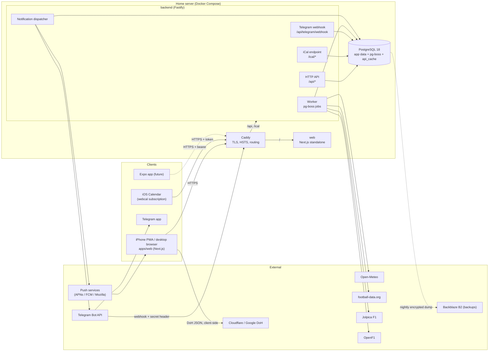

# Architecture

Single-user personal dashboard. The **server is the source of truth**: all scheduling, data fetching and notification dispatch happen in the backend; clients (PWA now, Expo later) only render and mutate through the API.

## 1. Components



| Component | Responsibility | Must not |
|---|---|---|
| Caddy | TLS termination, HSTS, path routing (`/api/*`, `/ical/*` → backend; rest → web), request size limits, access log | contain app logic |
| `apps/web` | UI, PWA manifest, service worker, push subscription UI, passkey ceremonies (browser side), client-side tools (subnet calc, DoH, hashes) | call keyed external APIs, hold secrets, implement business rules (those live in `core-domain`) |
| `apps/backend` API | Auth, CRUD, read models with spoiler redaction, Telegram webhook, iCal, health | block on external APIs inside a request (reads come from DB/cache) |
| `apps/backend` worker | Sync jobs, notification planning & dispatch, morning brief, cleanup | run in a request handler |
| PostgreSQL | Data, job queue (`pgboss` schema), API cache | — |

## 2. Backend structure

```
apps/backend/src/
  main.ts                 # composition root: config → db → plugins → modules → roles
  config.ts               # zod-validated env (fails fast on startup)
  db/                     # drizzle schema, migrations, client
  plugins/                # auth (session), rate-limit, security headers, error handler, request logging
  integrations/<source>/  # client.ts (fetch + limiter), schemas.ts (zod), mapper.ts (→ domain)
  modules/<module>/       # routes.ts, service.ts, repository.ts, jobs.ts
     auth, settings, notifications, push, telegram, brief, weather,
     sports (unified events, spoiler), football, f1, ical, deadlines, inbox, budget, tools, system
  jobs/registry.ts        # pg-boss job names, cron schedules, handlers
```
Layering inside a module: `routes → service → repository/integration`. Business rules are called from `@projectu/core-domain`; services orchestrate I/O around them.

## 3. Request flow (read)

1. Browser `GET /api/sports/events?from&to&sport` with `__Host-session` cookie.
2. Caddy → backend. `auth` plugin resolves session (hash lookup), rejects 401 otherwise.
3. Fastify validates query with zod (`@fastify/type-provider-zod`).
4. Service loads events from DB (never calls the provider inline), loads spoiler state, applies `core-domain` `resolveResultVisibility()` to every event → results stripped server-side when hidden.
5. Response serialised through the zod response schema (extra fields dropped) + `freshness: { fetchedAt, stale }` per source.

## 4. Data sync flow

```
pg-boss cron (UTC) → sync job → integration client (rate limiter, timeout) → zod parse
   → mapper → upsert domain tables (idempotent ON CONFLICT by provider external id)
   → api_cache update → data_source_status success
   → post-sync hooks: notification planner(s) for changed events
on failure: retry with backoff (pg-boss), data_source_status.consecutive_failures++,
            ≥3 → system notification; module serves last good data with stale=true
```

| Job | Schedule (UTC) | Notes |
|---|---|---|
| `football.sync-fixtures` | daily 04:00 | PL, PD, CL window −7 d…+60 d |
| `football.sync-standings` | daily 04:10 + triggered after matchday ends | stores matchday snapshots |
| `football.poll-live` | every 5 min, self-gating | only runs work if a followed match is in its live/result window |
| `f1.sync-schedule` | daily 04:20 | current season |
| `f1.poll-results` | every 10 min, self-gating | from session end +35 min until results stored (max +12 h) |
| `weather.refresh` | every 30 min | all locations in one call |
| `notifications.dispatch` | every minute | claims due rows |
| `brief.prepare` | materialised as notification | content built at send time |
| `system.cleanup` | daily 03:00 | expired sessions/challenges, old telegram updates, delivered notifications > 90 d |
| `system.heartbeat` | every 5 min | pings Healthchecks.io (optional) |

## 5. Notification pipeline

```
          ┌──────────── planners (idempotent) ────────────┐
event/deadline/settings change ──► compute desired notifications (core-domain)
                                   ──► UPSERT notification (dedupe_key UNIQUE)
                                       · new → pending
                                       · time changed & still pending → update scheduled_for
                                       · no longer desired (cancelled/postponed/deleted) → cancelled
          └────────────────────────────────────────────────┘
dispatch tick (every minute):
  BEGIN; SELECT … WHERE status='pending' AND scheduled_for<=now() FOR UPDATE SKIP LOCKED LIMIT 20;
  for each:
    1. expired? (expires_at <= now) → status=expired
    2. quiet hours? (core-domain isInQuietHours, type not exempt)
         → defer: scheduled_for = quiet end; if > expires_at → expired
    3. mark sending; COMMIT
    4. load fresh context (event, spoiler state, locale)
    5. render per channel (core-domain renderers + core-i18n), spoiler filter applied HERE
    6. for each enabled channel (notification_preference):
         INSERT notification_delivery (notification_id, channel) ON CONFLICT DO NOTHING
         → only if inserted: send (Telegram / Web Push to every subscription)
         → record result (provider message id, error)
    7. status = sent | failed (all channels failed → retry up to 3× with backoff, then failed)
```
Guarantees:
- **No duplicates**: `notification.dedupe_key` unique; per-channel `notification_delivery` unique; a crash between send and record can at worst duplicate one channel message (accepted, logged).
- **Spoiler safety**: content is rendered at send time from current spoiler state; result notifications for spoiler-protected sports never contain the score (they say "finished" + "Watched" button).
- **No stale alerts**: pre-event notifications have `expires_at = event start`; after downtime they expire instead of firing late.

Dedupe keys: `football:kickoff:{matchId}:{minutes}`, `football:result:{matchId}`, `f1:session:{sessionId}:{minutes}`, `f1:result:{sessionId}`, `deadline:{deadlineId}:{offsetDays}`, `brief:{localDate}`, `budget:{categoryId}:{month}:{threshold}`, `system:{source}:{date}`.

## 6. Spoiler filtering (single rule, applied everywhere)

`resolveResultVisibility({ event, spoilerEnabledForSport, watchedAt, now, autoRevealHours })` in `core-domain` returns
`{ kind: 'visible' } | { kind: 'hidden', revealsAt: Date } | { kind: 'not-finished' }`.

Visible iff event finished AND (event not followed OR spoiler off for sport OR watched OR `now ≥ finishedAt + 24 h`). Only followed events (favourite teams, PL headline match, F1 sessions) are protected.

| Surface | Enforcement point |
|---|---|
| API (events, match detail, F1 results) | backend service before serialisation; hidden fields are **absent** in JSON |
| Standings (PL/La Liga table, F1 championships) | if any followed event of the competition is hidden → serve snapshot as of the last fully-visible matchday/round + flag `asOf` |
| Morning brief | rendered at read/send time with the same function |
| Web Push / Telegram | rendered at send time; result notifications redacted |
| iCal | schedule only, never results (independent of spoiler state) |
| Driver comparison | season aggregates computed only from rounds whose race is visible |

## 7. Caching strategy

| Layer | What | TTL / invalidation |
|---|---|---|
| Domain tables | normalised events, teams, standings snapshots, results | upserted by sync jobs; the read model |
| `api_cache` | raw provider responses keyed by `(source, cache_key)` | per source (weather 30 min, fixtures 24 h, OpenF1 historical ∞); used for stale fallback and to avoid re-fetching immutable data |
| HTTP | API JSON: `Cache-Control: private, no-store`; static assets: immutable hashed; iCal: `Cache-Control: private, max-age=900` | — |
| Client | TanStack Query (stale 60 s, refetch on focus) | invalidated after mutations |
| Service worker | app shell + offline fallback page only; no API caching | versioned on deploy |

## 8. Error handling

- Typed errors: `AppError` discriminated union (`kind: 'not-found' | 'validation' | 'unauthorized' | 'forbidden' | 'conflict' | 'rate-limited' | 'upstream-unavailable'`) mapped to HTTP status in one Fastify error handler; response body `{ error: { code, message } }` without stack traces.
- Every `catch` either handles (with a log entry including context) or rethrows with `cause`. No empty catch.
- Integrations return `Result<T, IntegrationError>`; sync jobs throw to let pg-boss retry.
- Unhandled rejections / uncaught exceptions → log fatal, exit (Docker restarts the container).
- UI: each dashboard widget is an independent boundary; failure renders a compact error card, never blanks the page.

## 9. Observability

- Structured JSON logs (Fastify's pino) with `reqId`, `jobName`, `jobId`, `notificationId`; secrets/cookies/tokens redacted via pino `redact`.
- `GET /api/health/live` (process up) and `GET /api/health/ready` (DB query + pg-boss started) — unauthenticated, no details beyond status.
- In-app **System** page: `data_source_status`, failed jobs (last 7 days, from pg-boss), last notifications with delivery results, last backup timestamp (written by backup script to a status table via CLI).
- External dead-man's switch: `system.heartbeat` → Healthchecks.io; backup script pings its own check. Outage of the home server → e-mail.
- Docker log rotation (`json-file`, 10 MB × 5).

## 10. Expo readiness

| Concern | Prepared by |
|---|---|
| Types & validation | `core-schemas` (zod) |
| API access | `core-api-client` (fetch-based, base URL + auth strategy injected: cookie for web, bearer for native) |
| Business rules (spoiler, budget, subnet calc, formatting) | `core-domain`, `core-nettools`, `core-i18n` — no DOM/Node APIs |
| Auth | session table supports bearer tokens (`client_kind`); passkeys on native need Associated Domains (`/.well-known/apple-app-site-association` served by web) |
| Push | native push would be a third channel (`expo`) in `notification_preference`; pipeline unchanged |
| Data hooks | when Expo starts, TanStack Query hooks move from `apps/web/src/features/*/hooks` to `packages/feature-*` |

## 11. Dependencies (with reasons)

| Package | Where | Reason |
|---|---|---|
| `turbo` | root (dev) | task orchestration + caching |
| `typescript`, `eslint`, `typescript-eslint`, `prettier` | root (dev) | typecheck, lint, format |
| `vitest` | root (dev) | tests |
| `@testcontainers/postgresql` | backend (dev) | integration tests against real PostgreSQL |
| `zod` | core-schemas, backend, web | boundary validation, type derivation |
| `fastify`, `@fastify/type-provider-zod` | backend | HTTP server, schema-validated routes |
| `@fastify/cookie` | backend | session cookie parsing/setting |
| `@fastify/rate-limit` | backend | rate limits on auth, webhook, iCal |
| `drizzle-orm`, `drizzle-kit` (dev), `pg` | backend | query layer, migrations, driver (ADR 0003) |
| `pg-boss` | backend | jobs (ADR 0004) |
| `@simplewebauthn/server` / `@simplewebauthn/browser` | backend / web | WebAuthn ceremonies (ADR 0005) |
| `web-push` | backend | VAPID + payload encryption (ADR 0006) |
| `date-fns`, `@date-fns/tz` | core-domain | DST-safe zone math (ADR 0011) |
| `next`, `react`, `react-dom` | web | UI framework (given) |
| `@tanstack/react-query` | web | server-state caching, retries, focus refetch; portable to Expo |
| `tailwindcss` (dev) | web | styling without a component library |

Deliberately **not** added: Telegram SDK, HTTP client libs (native `fetch`), chart library (hand-written SVG charts — bar/line/donut are small), i18n library, iCal library (RFC 5545 subset hand-written with tests), helmet (headers set in Caddy + small hook), Redis.
