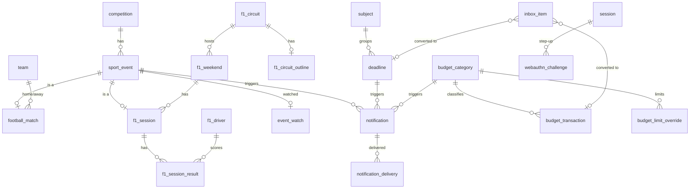

# Data model

PostgreSQL 18, Drizzle schema in `apps/backend/src/db/schema/*.ts`. This document is the design; the Drizzle schema is the implementation and must match it.

## Conventions
- Primary keys: `uuid DEFAULT uuidv7()` unless a natural key is better (noted). Provider ids are never primary keys; they live in `(provider, external_id)` unique pairs.
- `NOT NULL` by default. Nullable columns are listed with the meaning of NULL.
- Instants: `timestamptz` (UTC). Local calendar values: `date`.
- Money: `integer` minor units (cents), `> 0` for amounts; currency `char(3)` constrained to `'EUR'` for now.
- Enumerations: PostgreSQL enums (Drizzle `pgEnum`), mirrored by zod enums in `core-schemas` (derived, not duplicated by hand where possible).
- Every FK has an explicit `ON DELETE` and an index on the child column.
- No soft delete. Lifecycle is modelled with explicit `status` columns.
- **Single-user**: no `user_id` columns. Global settings are a singleton row. Multi-user is out of scope.
- `created_at timestamptz NOT NULL DEFAULT now()`; `updated_at` where rows are edited (set by the repository layer).

## Enums
Created by the migration of the first table that uses them. When an enum becomes part of the API contract, its values move to a zod enum in `core-schemas` and `pgEnum` is derived from it (as `locale` is).

| Enum | Values |
|---|---|
| `locale` | `sk`, `en` |
| `sport` | `football`, `f1` |
| `event_kind` | `football_match`, `f1_session` |
| `event_status` | `scheduled`, `live`, `finished`, `postponed`, `cancelled` |
| `f1_session_type` | `fp1`, `fp2`, `fp3`, `sprint_qualifying`, `sprint`, `qualifying`, `race` |
| `big_match_reason` | `favourite_team`, `round_headline` |
| `deadline_priority` | `low`, `medium`, `high` |
| `deadline_status` | `open`, `done` |
| `inbox_status` | `open`, `archived`, `converted` |
| `capture_source` | `app`, `telegram` |
| `category_kind` | `income`, `expense` |
| `notification_type` | `morning_brief`, `deadline_reminder`, `football_kickoff`, `football_result`, `f1_session_start`, `f1_result`, `budget_limit`, `system` |
| `notification_status` | `pending`, `sending`, `sent`, `failed`, `cancelled`, `expired` |
| `channel` | `web_push`, `telegram` |
| `delivery_status` | `sent`, `failed` |
| `session_scope` | `full`, `recovery` |
| `client_kind` | `web`, `native` |
| `challenge_kind` | `registration`, `authentication` |
| `auth_event_kind` | `setup_completed`, `login_succeeded`, `login_failed`, `passkey_added`, `passkey_removed`, `recovery_code_used`, `recovery_codes_regenerated`, `session_revoked`, `ical_token_rotated` |
| `ical_feed` | `sports`, `school` |
| `data_source` | `open_meteo`, `football_data`, `jolpica`, `openf1`, `telegram`, `web_push` |

---

## Settings & auth

### `app_settings` (singleton)
| Column | Type | Constraints / notes |
|---|---|---|
| `id` | `smallint` PK | `CHECK (id = 1)` |
| `locale` | `locale` | default `sk` |
| `timezone` | `text` | default `Europe/Bratislava`; validated as IANA zone in app |
| `brief_time` | `time` | default `07:00` |
| `quiet_hours_start` / `quiet_hours_end` | `time` | defaults `22:00` / `07:00`; may wrap midnight |
| `deadline_reminder_offsets_days` | `smallint[]` | default `{3,1}`; `CHECK (cardinality(deadline_reminder_offsets_days) <= 5)`; each value 1–30 validated by zod (array element ranges are not practical as CHECK) + test |
| `deadline_reminder_time` | `time` | default `08:00` |
| `spoiler_auto_reveal_hours` | `smallint` | default `24`, `CHECK (> 0 AND <= 720)` |
| `big_match_extra_top_count` | `smallint` | default `4`, `CHECK (0..10)` |
| `webauthn_user_handle` | `bytea NULL` | 32 random bytes, generated at setup; NULL = setup not completed |
| `updated_at` | `timestamptz` | |

### `webauthn_credential`
| Column | Type | Notes |
|---|---|---|
| `id` | uuid PK | |
| `credential_id` | `bytea` | `UNIQUE` |
| `public_key` | `bytea` | |
| `sign_count` | `bigint` | `CHECK (>= 0)` |
| `transports` | `text[]` | |
| `device_type` | `text` | `singleDevice` / `multiDevice` (CHECK) |
| `backed_up` | `boolean` | |
| `nickname` | `text` | `CHECK (length 1..60)` |
| `created_at`, `last_used_at` | `timestamptz` | `last_used_at` NULL = never used since registration |

Invariant: at least one credential must remain → enforced in service (deleting the last passkey is refused) + test.

### `recovery_code`
`id` uuid PK · `batch_id` uuid · `code_hash bytea UNIQUE` · `created_at` · `used_at timestamptz NULL` (NULL = unused).
Index: partial `(batch_id) WHERE used_at IS NULL`. Regeneration deletes all rows and inserts a new batch in one transaction.

### `webauthn_challenge`
`id` uuid PK · `kind challenge_kind` · `challenge bytea` · `session_id uuid NULL` (FK `session` ON DELETE CASCADE; set for step-up/recovery registrations) · `expires_at` (now + 5 min) · `created_at`.
Indexes `(expires_at)` for cleanup and `(session_id)` (FK). Consumed (deleted) on verification attempt, success or failure.

### `session`
| Column | Type | Notes |
|---|---|---|
| `id` | uuid PK | |
| `token_hash` | `bytea` | `UNIQUE`; SHA-256 of the cookie token |
| `scope` | `session_scope` | `recovery` sessions may only register a passkey |
| `client_kind` | `client_kind` | default `web` |
| `created_at`, `last_seen_at` | `timestamptz` | |
| `expires_at` | `timestamptz` | `CHECK (expires_at > created_at)`; recovery scope max 15 min (`CHECK`, so set `created_at` and `expires_at` from the same clock) |
| `elevated_until` | `timestamptz NULL` | NULL = no step-up |
| `user_agent` | `text` | truncated 300 chars |
| `ip` | `inet` | |

Index `(expires_at)`.

### `auth_event` (append-only audit)
`id` uuid PK · `kind auth_event_kind` · `ip inet NULL` (NULL for CLI) · `user_agent text NULL` · `detail text NULL` (e.g. passkey nickname) · `created_at`. Index `(created_at DESC)`. Retained 1 year.

### `ical_feed_token`
`id` uuid PK · `feed ical_feed` · `token_hash bytea UNIQUE` · `created_at` · `revoked_at timestamptz NULL` (NULL = active) · `last_accessed_at timestamptz NULL`.
Partial unique index `(feed) WHERE revoked_at IS NULL` → exactly one active token per feed. Rotation = revoke + insert in one transaction.

### Assumptions (P0-04c, 2026-11-26)
- `webauthn_user_handle` is nullable because the settings row is seeded by a migration, before the setup flow generates the handle.
- The 15-minute limit of recovery sessions is enforced by a `CHECK` in the database, not only by the service.

---

## Notifications

### `push_subscription`
`id` uuid PK · `endpoint text UNIQUE` · `p256dh text` · `auth text` · `user_agent text` · `label text` (e.g. "iPhone") · `created_at` · `last_success_at timestamptz NULL` · `consecutive_failures smallint DEFAULT 0 CHECK (>= 0)`.
Deleted on 404/410 from the push service or after 10 consecutive failures.

### `notification_preference`
PK `(type notification_type, channel channel)` · `enabled boolean`. Seeded with defaults (features/notifications.md). Missing row = disabled.

### `event_reminder_rule`
`id` uuid PK · `sport sport` · `f1_session_type f1_session_type NULL` (NULL for football; required for f1 — `CHECK ((sport='f1') = (f1_session_type IS NOT NULL))`) · `minutes_before smallint CHECK (5..1440)`.
`UNIQUE NULLS NOT DISTINCT (sport, f1_session_type, minutes_before)`.
Seed: football 60; f1 qualifying/sprint_qualifying/sprint/race 30; f1 race 120.

### `notification`
| Column | Type | Notes |
|---|---|---|
| `id` | uuid PK | |
| `type` | `notification_type` | |
| `dedupe_key` | `text` | `UNIQUE` (formats in ARCHITECTURE.md §5) |
| `status` | `notification_status` | default `pending` |
| `scheduled_for` | `timestamptz` | |
| `expires_at` | `timestamptz NULL` | NULL = never expires; `CHECK (expires_at IS NULL OR expires_at > created_at)` |
| `sport_event_id` | uuid NULL | FK `sport_event` ON DELETE CASCADE |
| `deadline_id` | uuid NULL | FK `deadline` ON DELETE CASCADE |
| `category_id` | uuid NULL | FK `budget_category` ON DELETE CASCADE |
| `params` | `jsonb` | small typed payload (e.g. `{ minutesBefore }`, `{ thresholdPercent, month }`, `{ localDate }`); validated by a zod discriminated union keyed by `type` on read/write — justified: varies per type, never queried |
| `attempts` | `smallint` | default 0, `CHECK (0..10)` |
| `last_error` | `text NULL` | |
| `created_at`, `updated_at` | | |
| `sent_at` | `timestamptz NULL` | `CHECK ((status = 'sent') = (sent_at IS NOT NULL))` |

`CHECK (num_nonnulls(sport_event_id, deadline_id, category_id) <= 1)` and per-type reference check (e.g. `type IN ('football_kickoff','football_result','f1_session_start','f1_result')` ⇒ `sport_event_id IS NOT NULL`).
Indexes: partial `(scheduled_for) WHERE status = 'pending'`; `(sport_event_id)`, `(deadline_id)`, `(category_id)`; `(created_at DESC)` for the System page.

### `notification_delivery`
`id` uuid PK · `notification_id` FK ON DELETE CASCADE · `channel channel` · `status delivery_status` · `provider_message_id text NULL` (Telegram `message_id`, used to edit on "watched") · `error text NULL` · `attempted_at`.
`UNIQUE (notification_id, channel)`.

### `telegram_update` (webhook dedupe)
`update_id bigint` PK · `received_at`. Cleanup after 7 days.

---

## Sports

### `competition`
`id` uuid PK · `sport sport` · `provider text` · `external_id text` · `code text` (e.g. `PL`, `PD`, `CL`, `F1`) · `name text` · `followed boolean`. `UNIQUE (provider, external_id)`, `UNIQUE (code)`.

### `team`
`id` uuid PK · `provider` · `external_id` · `name` · `short_name` · `tla char(3)` · `is_favourite boolean DEFAULT false` · `is_top_listed boolean DEFAULT false` (the configurable "top teams" list). `UNIQUE (provider, external_id)`.

### `sport_event` (unified calendar)
| Column | Type | Notes |
|---|---|---|
| `id` | uuid PK | |
| `kind` | `event_kind` | |
| `sport` | `sport` | `CHECK ((kind='football_match') = (sport='football'))` |
| `competition_id` | FK `competition` RESTRICT | |
| `provider`, `external_id` | `text` | `UNIQUE (provider, external_id)` |
| `starts_at` | `timestamptz` | |
| `ends_at` | `timestamptz` | estimated until finished (football +2 h, F1 per session type), then actual/derived; `CHECK (ends_at > starts_at)` |
| `status` | `event_status` | |
| `finished_at` | `timestamptz NULL` | NULL = not finished; `CHECK ((status='finished') = (finished_at IS NOT NULL))`; base for 24 h auto-reveal |
| `is_followed` | `boolean` | favourite team, PL headline match, or any F1 session — drives notifications, spoiler protection and standings snapshots |
| `updated_at` | | |

Indexes: `(starts_at)`, `(sport, starts_at)`, partial `(starts_at) WHERE is_followed`, `(competition_id)`.

### `football_match` (1:1 subtype)
`event_id` PK FK `sport_event` ON DELETE CASCADE · `home_team_id`, `away_team_id` FK `team` RESTRICT (`CHECK home <> away`) · `season smallint` (start year, e.g. 2026 for 2026/27) · `matchday smallint NULL` (NULL for knockout stages) · `stage text` · `home_score smallint NULL`, `away_score smallint NULL` (`CHECK ((home_score IS NULL) = (away_score IS NULL))`, both `>= 0`) · `score_duration text NULL` (`REGULAR`/`EXTRA_TIME`/`PENALTY_SHOOTOUT`) · `is_big_match boolean` · `big_match_reason big_match_reason NULL` (`CHECK (is_big_match = (big_match_reason IS NOT NULL))`; `CHECK (big_match_reason <> 'round_headline' OR matchday IS NOT NULL)`).
Indexes: `(home_team_id)`, `(away_team_id)`; partial unique `(season, matchday) WHERE big_match_reason = 'round_headline'` — one headline per matchday (headlines are computed for PL only).

### `football_standing` (snapshots)
PK `(competition_id, season smallint, matchday smallint, team_id)` · `position smallint` · `played, won, draw, lost, goals_for, goals_against, points smallint` (all `>= 0`) · `fetched_at`. Latest = max matchday.

### F1
| Table | Columns / constraints |
|---|---|
| `f1_circuit` | `id` uuid PK · `jolpica_circuit_id text UNIQUE` · `name` · `locality` · `country` · `latitude numeric(8,5)` · `longitude numeric(8,5)` · `length_km numeric(5,3) NULL` (NULL = not curated) · `wiki_url text` |
| `f1_circuit_outline` | `circuit_id` PK FK CASCADE · `points jsonb` (array of `[x,y]` normalised 0..1000, ≤ 600 points; validated by zod) · `source_session_key integer` · `generated_at` |
| `f1_weekend` | `id` uuid PK · `season smallint` · `round smallint` · `name` · `circuit_id` FK RESTRICT · `is_sprint boolean` · `UNIQUE (season, round)` |
| `f1_session` | `event_id` PK FK `sport_event` CASCADE · `weekend_id` FK CASCADE · `session_type f1_session_type` · `openf1_session_key integer NULL` (NULL until mapped) · `UNIQUE (weekend_id, session_type)` |
| `f1_driver` | `id` uuid PK · `jolpica_driver_id text UNIQUE` · `code char(3) NULL` · `permanent_number smallint NULL` · `given_name` · `family_name` · `nationality` |
| `f1_constructor` | `id` uuid PK · `jolpica_constructor_id text UNIQUE` · `name` · `nationality` |
| `f1_session_result` | PK `(session_event_id, driver_id)` · `constructor_id` FK · `position smallint NULL` (NULL = not classified) · `grid smallint NULL` · `points numeric(4,1) CHECK (>= 0)` · `status text` · `laps smallint NULL` · `time_text text NULL` · `q1, q2, q3 text NULL` (qualifying) · `UNIQUE (session_event_id, position)` (partial, position not null) |
| `f1_driver_standing` | PK `(season, round, driver_id)` · `position` · `points numeric(5,1)` · `wins smallint` |
| `f1_constructor_standing` | PK `(season, round, constructor_id)` · `position` · `points` · `wins` |

### Spoilers
- `spoiler_setting`: PK `sport` · `enabled boolean` (seed: both `true`).
- `event_watch`: PK `event_id` FK `sport_event` CASCADE · `watched_at`. Presence = watched. "Unwatch" deletes the row.

---

## School

### `subject`
`id` uuid PK · `code text UNIQUE` (e.g. `PRPR`) · `name text` · `color char(7) CHECK (~ '^#[0-9a-f]{6}$')` · `status` (`active`/`archived` enum `subject_status`).

### `deadline`
| Column | Type | Notes |
|---|---|---|
| `id` | uuid PK | |
| `title` | `text` | `CHECK (length 1..200)` |
| `subject_id` | uuid NULL | FK `subject` RESTRICT; NULL = no subject |
| `due_at` | `timestamptz` | |
| `priority` | `deadline_priority` | default `medium` |
| `status` | `deadline_status` | default `open` |
| `completed_at` | `timestamptz NULL` | `CHECK ((status='done') = (completed_at IS NOT NULL))` |
| `notes` | `text` | default `''` |
| `reminder_offsets_days` | `smallint[] NULL` | NULL = use settings default; empty array = no reminders |
| `created_at`, `updated_at` | | |

Indexes: `(status, due_at)`, `(subject_id)`.

---

## Inbox

### `inbox_item`
`id` uuid PK · `body text CHECK (length 1..4000)` · `url text NULL` (NULL = no link detected; `CHECK (url ~ '^https?://')`) · `source capture_source` · `status inbox_status` default `open` · `converted_deadline_id` FK `deadline` SET NULL, NULL · `converted_transaction_id` FK `budget_transaction` SET NULL, NULL · `triaged_at timestamptz NULL` · `created_at`.
Checks: `(status = 'open') = (triaged_at IS NULL)`; `num_nonnulls(converted_deadline_id, converted_transaction_id) <= 1`; `status <> 'converted' OR triaged_at IS NOT NULL`. (A converted item whose target is later deleted keeps `status='converted'` with both FKs NULL — acceptable history.)
Index: partial `(created_at) WHERE status = 'open'`.

---

## Budget

### `budget_category`
`id` uuid PK · `kind category_kind` · `slug text UNIQUE` (`CHECK (~ '^[a-z0-9-]{2,30}$')`, used by Telegram) · `name text` · `aliases text[]` (alternative Telegram words, lower-case, e.g. `{food}` for `jedlo`) · `default_monthly_limit_cents integer NULL` (NULL = no limit; `CHECK (>= 0)`; only for `expense` — `CHECK (kind='expense' OR default_monthly_limit_cents IS NULL)`) · `sort_order smallint` · `status` (`active`/`archived`).
Seed expenses: `jedlo` Jedlo, `doprava` Doprava, `internat` Internát, `skola` Škola, `zabava` Zábava, `predplatne` Predplatné, `zdravie` Zdravie, `ine` Iné. Seed income: `vyzivne` Výživné, `vreckove` Vreckové, `brigada` Brigáda, `ine-prijem` Iné.
Alias uniqueness across categories enforced in service (array uniqueness across rows not expressible) + test.

### `budget_limit_override`
PK `(category_id, month)` · `month date CHECK (extract(day from month) = 1)` · `limit_cents integer CHECK (>= 0)`. FK CASCADE.

### `budget_transaction`
| Column | Type | Notes |
|---|---|---|
| `id` | uuid PK | |
| `category_id` | FK `budget_category` RESTRICT | kind (income/expense) comes from category |
| `amount_cents` | `integer` | `CHECK (amount_cents > 0 AND amount_cents <= 10000000)` |
| `currency` | `char(3)` | `CHECK (currency = 'EUR')` |
| `occurred_on` | `date` | local date |
| `note` | `text` | default `''` |
| `source` | `capture_source` | |
| `idempotency_key` | `uuid NULL` | `UNIQUE`; set by client/Telegram (`update_id`-derived) to make retries safe |
| `created_at`, `updated_at` | | |

Indexes: `(occurred_on)`, `(category_id, occurred_on)`.

---

## Briefs, cache, system

### `morning_brief`
`local_date date` PK · `generated_at` · `content jsonb` (structured snapshot validated by zod `BriefContent`: weather per location, deadline ids, event ids — results are **not** stored; redaction happens at render time).

### `weather_location`
`id` uuid PK · `name text UNIQUE` · `latitude numeric(8,5) CHECK (-90..90)` · `longitude numeric(8,5) CHECK (-180..180)` · `sort_order smallint UNIQUE` · `is_primary boolean NOT NULL DEFAULT false` · `show_in_brief boolean NOT NULL DEFAULT false`. Partial unique index `(is_primary) WHERE is_primary` — at most one primary location. **No seed**: locations are personal data and are added in the app via geocoding search; the first added location becomes primary.

### `api_cache`
PK `(source data_source, cache_key text)` · `payload jsonb` · `http_status smallint` · `etag text NULL` · `fetched_at` · `expires_at` (`CHECK (expires_at >= fetched_at)`). Raw provider payloads (genuinely third-party → jsonb justified).

### `data_source_status`
PK `source data_source` · `last_success_at NULL` · `last_failure_at NULL` · `last_error text NULL` · `consecutive_failures integer DEFAULT 0 CHECK (>= 0)`.

### `backup_run`
`id` uuid PK · `started_at` · `finished_at NULL` · `succeeded boolean NULL` (NULL = running) · `size_bytes bigint NULL` · `message text NULL`. Written by `backend backup:record` CLI from the backup script.

### Scheduled jobs
Owned by pg-boss in schema `pgboss` (created/migrated by pg-boss itself, excluded from Drizzle migrations). Job names and cron schedules are code (`apps/backend/src/jobs/registry.ts`).

---

## Relations overview

